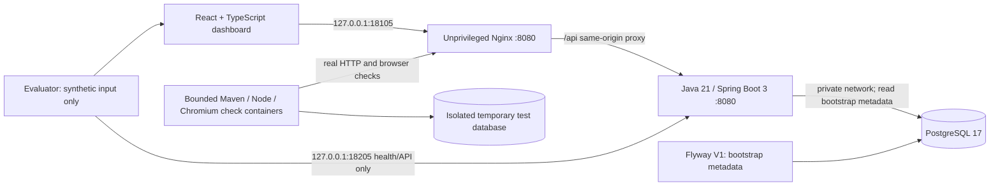

# Architecture

## Phase 1: one small vertical slice

Web and API use the project-owned `edge` bridge for the two loopback-published
ports. API and PostgreSQL additionally share the internal `private` network;
PostgreSQL is connected only to that private network and has no host port.
The web server and browser test cannot directly reach PostgreSQL.
Build/check tools use separate project-owned networks where dependency
downloads are necessary. There is no runtime internet dependency, Docker socket,
host repository mount, external telemetry exporter, or agent executor.

Docker 29 suppressed effective host port bindings when the first stack used
only an internal network, even though its container health checks passed.
The edge bridge corrects that verified failure without exposing PostgreSQL or
binding either application port beyond loopback. It permits network egress from
web/API containers at the Docker layer; the application makes no external calls.

## Components

- `apps/web`: React/TypeScript, Vite, plain CSS, typed and runtime-checked API
  boundary, explicit loading/error states, and frontend tests.
- `services/api`: Spring Boot MVC, Bean Validation, JDBC, PostgreSQL, Flyway,
  Actuator, sanitized Problem Details, and structured console logs.
- `packages/contracts`: versioned OpenAPI contract for the skeleton only.
- `infra/docker`: Compose and immutable application image definitions.
- `tests/e2e`: actual Chromium tests of the deployed local stack.
- `scripts`: project-scoped initialization and deterministic verification.
- `docs`: requirements, boundaries, decisions, progress, and observed evidence.

Worker and benchmark directories are intentionally not filled with placeholder
implementations. They are created only when their later phase is authorized.

## Persistence

Flyway owns schema creation. Version 1 creates one `app_metadata` row containing
schema version `1`. This is synthetic bootstrap state, not the future domain
model. The API reads it to prove the database and migration are part of the
working slice. There are no application write endpoints.

The application database has a project-owned persistent volume. The check
database has a different database name/service and temporary storage, so
automated tests never depend on or reset the application database. Reapplying
Flyway is safe; destructive automatic rollback and Flyway clean are disabled.
For an empty local bootstrap only, a future approved rollback may drop the
metadata table; no destructive rollback is executed in this session.

## API and failures

The OpenAPI file is the contract for this phase. Java records and TypeScript
boundary validation represent its small payloads. Contract behavior is checked
through integration and browser HTTP tests.

- HTTP 200: database-backed system status or valid, validation-only input.
- HTTP 400: invalid fields, unknown fields, or malformed JSON.
- HTTP 503: a database read cannot complete.
- No endpoint silently substitutes mock state when the database fails.
- Frontend failures are visible and can be retried without page reload.
- Actuator exposes health only; configuration and environment are not exposed.
- JSON console logs and generated request IDs support local diagnosis without
  logging request bodies. Full distributed tracing belongs to Phase 5.

## Runtime budgets

| Service  | CPU ceiling | Memory ceiling | PID ceiling |
| -------- | ----------: | -------------: | ----------: |
| api      |        0.75 |        512 MiB |         128 |
| web      |        0.25 |         64 MiB |          64 |
| db       |        0.50 |        256 MiB |         128 |
| api-tool |        1.00 |       1024 MiB |         192 |
| web-tool |        1.00 |        768 MiB |         128 |
| e2e-tool |        1.00 |        768 MiB |         128 |
| test-db  |        0.50 |        256 MiB |         128 |
| e2e      |        1.00 |        768 MiB |         256 |

Long-running services total at most **1.5 CPUs and 832 MiB**. Verification runs
tooling serially with one test worker. Compiler/package commands run in bounded
containers, rather than unconstrained multi-stage Docker builds. Docker builds
only assemble already-verified artifacts.

## Later architecture, not implemented

Phase 2 introduces `projects`, `specs`, `tasks`, `dependencies`, `worktrees`,
`checks`, and `merge_requests`, plus permission and retry contracts.
Phase 3 implements the planner and deterministic gates.
Phase 4 introduces explicitly authorized agent adapters and worktrees.
Redis, Kafka, and event consumers are deferred until asynchronous behavior is
needed. No future module is advertised as working today.
